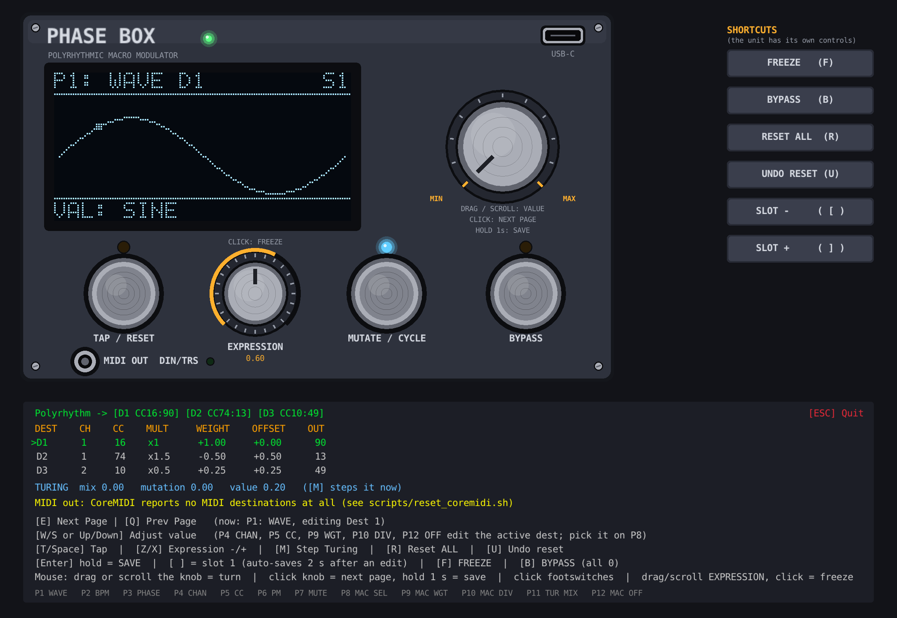

# Phase Box 🎛️

> **RP2040-Powered Polyrhythmic Modulation Engine & MIDI Synthesizer**

Phase Box is a dedicated hardware modulation engine and MIDI generator built on the Raspberry Pi RP2040. It translates algorithmic phase accumulators, generative LFSR Turing machine registers, and polyrhythmic macro scaling into real-time MIDI Control Change (CC) streams over both **DIN/TRS 31,250 baud serial MIDI** and **class-compliant USB-MIDI**.

Designed specifically for controlling video synthesizers (such as LZX Industries, Auto Waaaves, and r_e_c_u_r), modular audio rigs, and DAWs.



*The Raylib desktop simulator (`./build-native/phase_box_native_sim`).*

---

## 📚 Documentation Quick Links

* 📖 **[User Guide & Operating Manual](docs/USER_GUIDE.md)**: Hardware controls, menu pages, tap tempo, footswitches, expression encoder, screensaver, and desktop simulator guide.
* 🛠️ **[Developer & Architecture Guide](docs/DEVELOPER_GUIDE.md)**: Dual-core architecture, signal flow diagrams, **"C++ Crash Course for Python Programmers"**, and step-by-step contribution recipes.
* 🎨 **[Raylib Desktop UI Guide](docs/RAYLIB_UI_GUIDE.md)**: Beginner-friendly guide to modifying the desktop simulator GUI, colors, controls, and Raylib primitives.
* 📐 **[Context Handover Blueprint](docs/phase_box_context_handover_blueprint.md)**: Complete implementation state and execution phases.
* 📝 **[Releases](https://github.com/wsjk/phase-box/releases)**: The changelog. Every merge to `main` is tagged and released, and the notes list the merged PRs. The version shows in the simulator's title bar and in `picotool info` for the firmware.

---

## ⚡ Key Features

- **Asymmetric Dual-Core Architecture:**
  - **Core 0 (Real-Time Control & MIDI Engine):** Quadrature decoding of both rotary encoders (value + expression), switch debouncing, 60 Hz modulation engine step, Turing LFSR mutation, bandwidth-managed MIDI CC dispatch over UART (31,250 baud on GP0) and TinyUSB USB-MIDI, and 30 FPS OLED frame rendering into lock-free shared buffers.
  - **Core 1 (Async Display & Screen Saver):** Dedicated SSD1306 128×32/64 OLED driver on `i2c0` offloading all display traffic from Core 0 via lock-free seqlock framebuffers, plus automatic screen burn-in contrast dimming.
- **Polyrhythmic Macro Engine:** Independent clock multipliers/subdivisions per CC destination (0.125× to 8×: 1/8×, 1/4×, 1/2×, 3/4×, 1×, 1.5×, 2×, 3×, 4×, 8×) for generative, non-repeating modulation patterns.
- **Expression Encoder:** A second rotary encoder sets a global depth (0.00–1.00 in 20 clicks) that scales every destination from 50% to 100%.
- **Generative Turing LFSR:** 16-bit shift register with probabilistic mutation stepped per master cycle or manual footswitch tap.
- **Performance Controls:** Freeze (expression encoder click), bypass (third footswitch), reset / undo (hold both left footswitches 2 s) and 8 preset slots (press and turn the encoder).
- **Presets in Flash:** 8 slots saved to the last 64 KB of the RP2040's flash, with 2 s auto-save, wear levelling and power-loss-safe writes.
- **Dual MIDI Output:** Hardware serial MIDI (31,250 baud on GP0) and plug-and-play USB-MIDI class compliance (TinyUSB).
- **Desktop Simulator:** Native Raylib desktop visualizer featuring a realistic stompbox enclosure UI, interactive mouse knob dragging (circular or vertical) and wheel detents, drag/scroll expression encoder with value ring, clickable footswitches (TAP, MUTATE, BYPASS), click-to-freeze expression encoder, live waveform visualizer, preset management, freeze, and bypass modes. Routes directly to macOS `CoreMIDI` (defaulting to `FRASIL FM-1` or virtual DAW port).
- **Zero-Hardware Testing:** Fully decoupled Hardware Abstraction Layer (HAL) with a GoogleTest host test suite (`tests/`, 186 unit tests across 41 test suites).

---

## 🔌 Hardware Pinout

| Peripheral | RP2040 Pin | Hardware Role |
| :--- | :--- | :--- |
| **MIDI Serial** | **GP0** (TX), **GP1** (RX) | `uart0` running at 31,250 baud (8N1). |
| **Rotary Encoder** | **GP2** (A), **GP3** (B), **GP6** (Switch) | Navigation, velocity-accelerated tuning, hold-to-save, press-and-turn for preset slot. |
| **OLED Display** | **GP4** (SDA), **GP5** (SCL) | `i2c0` at 400 kHz; 1 MHz is optional and beyond the SSD1306's rating (Address: `0x3C`, 128×32 or 128×64). |
| **Footswitch 1** | **GP10** | Tap tempo (40–300 BPM) & instant phase reset. |
| **Footswitch 2** | **GP11** | Turing shift register mutation trigger / cycle. Hold with Footswitch 1 for 2 s: reset / undo reset. |
| **Footswitch 3** | **GP12** | Bypass on / off. |
| **Expression Encoder** | **GP7** (A), **GP8** (B), **GP9** (Switch) | Global modulation depth, 20 clicks from 0.00 to 1.00. Click: freeze on / off. |
| **USB** | **USB D+ / D-** | Class-compliant TinyUSB MIDI device streaming. |

---

## 🚀 Quick Start Workflows

### 1. Build and Run the Desktop Simulator (macOS)
```bash
cmake -B build-native -S . -DCMAKE_POLICY_VERSION_MINIMUM=3.5
cmake --build build-native -j4
./build-native/phase_box_native_sim
```
*Sends MIDI straight to the hardware destination named **`FRASIL FM-1`** (change it with `PHASE_BOX_MIDI_DEST="Some Synth"`; `PHASE_BOX_MIDI_DEST=virtual` gives a virtual port for a DAW). `--list-midi` shows what CoreMIDI sees. If macOS MIDI is stuck, see `bash scripts/reset_coremidi.sh`.*

### 2. Run Host Unit Tests (GoogleTest)
```bash
cmake -S tests -B build-test -DCMAKE_POLICY_VERSION_MINIMUM=3.5
cmake --build build-test -j4
./build-test/run_host_tests
# Or helper script: ./.agents/skills/phase-box/scripts/build_host.sh
```
*(Runs all 186 tests covering DSP math, hardware abstraction layers, DeviceApp simulation, preset session persistence, SimLayout geometry, and CoreMIDI routing).*

### 3. Compile RP2040 Target Firmware (`.uf2`)
```bash
# Helper script (auto-detects SDK and toolchain):
./.agents/skills/phase-box/scripts/build_pico.sh

# Or manual execution:
export PATH="/Applications/CMake.app/Contents/bin:/Users/ww/tools/xpack-arm-none-eabi-gcc-15.2.1-1.1/bin:$PATH"
export PICO_SDK_PATH="/Users/ww/src/pico-sdk"
cmake -S firmware -B firmware/build -DPICO_SDK_PATH="$PICO_SDK_PATH"
cmake --build firmware/build -j4
```
*Drag-and-drop `firmware/build/phase_box_firmware.uf2` to your Raspberry Pi Pico in BOOTSEL mode.*
