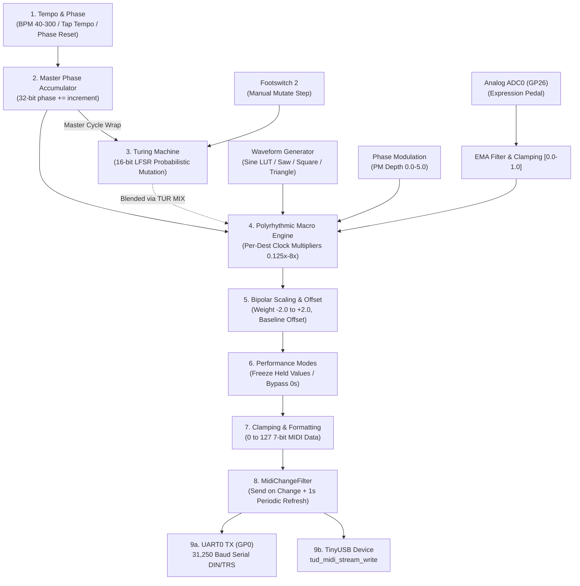

# Phase Box: Developer Architecture & C++ Engineering Guide

> **Implementation status (read first).** The primary production architecture is unified around **`DeviceApp`** (`include/DeviceApp.hpp`), which encapsulates all hardware controls, parameter editing, modulation math, preset sessions, and rendering:
> - **Shared Engine:** The RP2040 firmware target (`firmware/src/firmware_main.cpp`), the native desktop simulator (`src/native_sim_main.cpp`), and the GoogleTest host suite (`tests/test_device_app.cpp` driving the full device against mock inputs) all execute this identical engine and menu logic (pages P1–P12).
> - **Dual-Core Workload:** In the RP2040 firmware, Core 0 handles real-time input polling, 60 Hz modulation engine stepping, MIDI change filtering and dispatch over both UART (GP0 at 31,250 baud) and USB (TinyUSB), and 30 FPS OLED frame rendering. Core 1 strictly owns the `i2c0` bus to copy rendered frames to the SSD1306 panel via a lock-free `SeqlockBuffer` and manage `ScreenSaver` contrast dimming, preventing slow I2C transfers from ever stalling real-time MIDI generation.
> - **Preset Sessions:** `PresetSession` (`include/PresetSession.hpp`) manages auto-save (2 s of idle), hold-to-save (1 s encoder hold), slots 1–8, and OLED status messaging. On macOS/Linux/Windows, the simulator and tests use `FilePresetStorage` (`preset_*.bin`). On RP2040, `NoStorage` is currently linked until LittleFS flash storage with multicore lockout is added (`NO STORAGE` message on hold-to-save).
> - **Early Layered Prototype:** `src/main.cpp` and `include/core/` are earlier experimental prototypes that are not part of any CMake build target. All active development, firmware flashing, desktop simulation, and tests build from `include/`, `src/`, `firmware/`, and `tests/`.


This document is the comprehensive architectural specification and developer guide for the **Phase Box** firmware. It details the internal signal flow, dual-core operational model, and code layout.

> [!TIP]
> **For Python Developers:** If you are coming from Python or higher-level languages and want to learn modern embedded C++, see [Section 4: C++ for Pythonistas](#4-c-crash-course-for-python-programmers).

---

## 1. System Architecture & Dual-Core Division

The Raspberry Pi RP2040 contains two 32-bit ARM Cortex-M0+ processor cores operating at 125 MHz. Phase Box uses an **Asymmetric Multiprocessing (AMP)** model to guarantee hard real-time timing for MIDI generation without visual or I/O stutter.

```
+========================================================================+
|                              RP2040 SOC                                |
|                                                                        |
|  +--------------------------------+  +-------------------------------+ |
|  |             CORE 0             |  |            CORE 1             | |
|  |  (Real-Time Engine & MIDI Out) |  |   (Async Display & Screen)    | |
|  |                                |  |                               | |
|  |  [High-Frequency Polling Loop] |  |  [Async Display Service Loop] | |
|  |   - Quadrature Decoder (GP2,3) |  |   - SSD1306 OLED via I2C0     | |
|  |   - Debounced Switches (GP6,10,|  |     (GP4 SDA, GP5 SCL)        | |
|  |     GP11: Enc, Tap, Mutate)    |  |   - Reads Seqlock Frame Buffer| |
|  |   - ADC0 Expr. Pedal (GP26)    |  |   - ScreenSaver Dimming       | |
|  |   - TinyUSB Service (tud_task) |  |     (30 s Idle -> 0x01 min)   | |
|  |  [60 Hz Frame Execution]       |  |   - Zero Real-Time Blocking   | |
|  |   - Master Phase & Turing LFSR |  +-------------------------------+ |
|  |   - Polyrhythmic Macro Scaling |                  ^                 |
|  |   - MidiChangeFilter (DIN Rate)|                  |                 |
|  |   - UART0 MIDI (GP0 31.25k Bd) |     [SeqlockBuffer<FRAME_BYTES>]   |
|  |   - TinyUSB MIDI Packet Stream |     [std::atomic g_last_activity]  |
|  |   - OLED Render -> Seqlock     |                  |                 |
|  +--------------------------------+                  |                 |
|                   |                                  |                 |
|                   +----------------------------------+                 |
+========================================================================+
```

### Why Core Separation Matters
1. **Eliminating I/O Jitter:** Writing a 512-byte display buffer over I2C at 400 kHz takes ~12 ms. If executed on the same core as MIDI generation, it would cause severe timing jitter and dropped MIDI packets. By dedicating Core 1 to the display bus, Core 0's loop runs completely unimpeded.
2. **Lock-Free Inter-Core Transfer:** Display frames are passed from Core 0 to Core 1 using a lock-free single-producer single-consumer sequence lock buffer (`SeqlockBuffer`). Core 0 never waits on Core 1 or acquires blocking mutexes.
3. **Bandwidth Management:** Standard DIN MIDI runs at 31,250 baud (~3,125 bytes/second). Sending multiple raw 3-byte CC messages every millisecond would quickly saturate the serial line. `MidiChangeFilter` ensures CC messages are only transmitted when values change (plus a periodic 1-second refresh), keeping bandwidth usage well within hardware limits.

---

## 2. Complete Signal Flow Pipeline

At 60 Hz (`FRAME_US` = 16,667 µs), the modulation pipeline computes new MIDI CC values following this deterministic pipeline:



### Signal Stages in Detail

1. **Master Phase Accumulation & Tap Tempo:**
   Phase accumulates based on master BPM ($40.0 - 300.0$ BPM):
   $$\Delta \theta = \frac{\text{BPM}}{60} \cdot \Delta t$$
   Tapping Footswitch 1 (GP10) calculates the interval between taps (rolling average up to 4 taps) and instantly resets all phase accumulators to $0^\circ$ for lock-step synchronization.

2. **Turing Mutation Shift Register:**
   A 16-bit recirculating shift register (`TuringMachine`). On each complete wrap of the master oscillator, the high bit is recirculated to bit 0 with probabilistic mutation set by `P7: MUT` ($0.0 - 1.0$). Footswitch 2 (GP11) or the simulator `[M]` key immediately steps and seeds the register. The 8-bit normalized output is blended into destinations according to `P11: TUR MIX`.

3. **Polyrhythmic Macro Destination Evaluation:**
   Each of the 3 macro destinations tracks its own effective phase scaled by its clock multiplier:
   $$\theta_{\text{dest}} = (\theta_{\text{master}} \cdot \text{clock\_mult}) \pmod{2\pi}$$
   Available multipliers: $0.125\times$, $0.25\times$, $0.5\times$, $0.75\times$, $1\times$, $1.5\times$, $2\times$, $3\times$, $4\times$, $8\times$.
   The synthesis waveform (Sine LUT, Sawtooth, Square, or Triangle with optional Phase Modulation) is evaluated at $\theta_{\text{dest}}$ and blended with the Turing register:
   $$\text{raw} = (1 - \text{tur\_mix}) \cdot \text{wave}(\theta_{\text{dest}}) + \text{tur\_mix} \cdot \text{turing\_norm}$$
   The resulting value is scaled by the destination's bipolar weight, offset, and expression pedal attenuation:
   $$\text{value} = \text{clamp}\left(\Big((\text{raw} \cdot \text{scale} \cdot \text{expression}) + \text{offset}\Big) \cdot 127,\ 0,\ 127\right)$$

4. **Performance Modes (Freeze & Bypass):**
   - **Freeze (`[F]`):** Halts oscillator advancement and latches every destination at its current live value. Releasing freeze resumes modulation from the exact latched phase without jumps.
   - **Bypass (`[B]`):** Forces all destination outputs to send 0 while internal LFOs continue advancing silently in time. Bypass takes priority over Freeze.

5. **Bandwidth Filtering & Dual MIDI Dispatch:**
   `MidiChangeFilter` tracks the last sent value per destination and transmits only when values change or every 1,000 ms as a keep-alive refresh. Messages are fanned out concurrently to:
   - Hardware UART0 TX (GP0) at 31,250 baud (DIN/TRS).
   - Class-compliant USB-MIDI via TinyUSB (`tud_midi_stream_write`).

---

## 3. Directory Layout & Module Index

```
phase-box/
├── include/                     # Public C++ Header Files (Unified Engine & Drivers)
│   ├── DeviceApp.hpp            # Main hardware-injected application runner (tested on host)
│   ├── PhaseBoxState.hpp        # Core synthesizer state (oscillator, Turing, macros, freeze, bypass)
│   ├── PhaseOscillator.hpp      # Poly-shape phase oscillator (Sine, Saw, Square, Tri) with PM
│   ├── MacroEngine.hpp          # Polyrhythmic macro matrix & per-destination clock multipliers
│   ├── TuringMachine.hpp        # 16-bit generative LFSR shift register with mutation
│   ├── SimControls.hpp          # Pages P1-P12: edit rules, footers, waveform curve generation
│   ├── OledRenderer.hpp         # SSD1306 screen layout for 128x32 and 128x64 OLED panels
│   ├── PresetSession.hpp        # Auto-save (2s idle), hold-to-save (1s), slots 1-8, status strings
│   ├── ScreenSaver.hpp          # OLED burn-in protection: 30s timeout contrast dimming
│   ├── TapTempo.hpp             # 4-tap rolling average tap tempo (40-300 BPM)
│   ├── MidiChangeFilter.hpp     # DIN MIDI bandwidth limiter (send on change + periodic refresh)
│   ├── MidiRouter.hpp           # CoreMIDI endpoint discovery, auto-reconnect, and routing
│   ├── CoreMidiBackend.hpp      # macOS CoreMIDI system wrapper
│   ├── hal/                     # Hardware Abstraction Layer (HAL)
│   │   ├── pinout.hpp           # Hardware pin assignments (single source of truth)
│   │   ├── quadrature.hpp       # Quadrature rotary encoder decoder
│   │   ├── debounce.hpp         # Software debounce filter for buttons & footswitches
│   │   ├── frame_buffer.hpp     # Monochrome 128x32/64 OLED frame buffer
│   │   ├── seqlock_buffer.hpp   # Lock-free single-writer single-reader inter-core frame buffer
│   │   ├── hal_adc.hpp          # ADC input interface & EMA smoothing
│   │   ├── hal_display.hpp      # Display interface definitions
│   │   ├── pico_hal_display.hpp # RP2040 hardware I2C SSD1306 driver
│   │   ├── pico_hal_midi.hpp    # RP2040 hardware UART0 MIDI driver
│   │   ├── pico_hal_adc.hpp     # RP2040 hardware ADC driver
│   │   └── mock_*.hpp           # GoogleTest mocks for zero-hardware testing
│   └── core/                    # Early layered prototypes (see Implementation Status)
├── src/                         # C++ Implementations
│   ├── native_sim_main.cpp      # Standalone Raylib desktop simulator (macOS CoreMIDI, direct destination)
│   ├── PhaseOscillator.cpp      # Phase accumulator & math implementation
│   ├── hal/                     # Concrete HAL driver implementations (hal_adc.cpp, etc.)
│   └── main.cpp                 # UNBUILT: early layered-engine experiment
├── firmware/                    # Standalone RP2040 Pico SDK Target (TinyUSB)
│   ├── CMakeLists.txt           # Cross-compilation CMake configuration
│   ├── pico_sdk_import.cmake    # Raspberry Pi Pico SDK CMake import script
│   ├── src/firmware_main.cpp    # Hardware setup, TinyUSB, Core 0 / Core 1 task loops
│   ├── src/usb_descriptors.c    # USB MIDI class-compliant descriptors
│   ├── include/PresetManager.hpp# Preset serialization, binary CRC validation, and storage interface
│   ├── include/tusb_config.h    # TinyUSB stack configuration
│   └── include/usb_descriptors.h# USB descriptor headers
├── tests/                       # GoogleTest Host Unit Tests (149 tests across 37 suites)
│   ├── CMakeLists.txt           # Standalone test runner build
│   ├── test_device_app.cpp      # Full DeviceApp test driven by mock pins & inputs
│   ├── test_device_blocks.cpp   # Isolated tests for Quadrature, Debounce, TapTempo, ScreenSaver
│   ├── test_sim_controls.cpp    # Parameter adjust rules, footers, waveform curves for P1-P12
│   ├── test_preset_session.cpp  # Auto-save, hold-to-save, dirty marks, slots 1-8
│   ├── test_midi_router.cpp     # Destination matching, auto-reconnect, CoreMIDI routing
│   ├── test_macro_engine.cpp    # Polyrhythmic multipliers & bipolar destination scaling
│   ├── test_hal_adc.cpp         # EMA filtering & ADC deadband clamping
│   ├── test_hal_display.cpp     # OLED framebuffer bounds & raster operations
│   ├── test_hal_encoder.cpp     # Encoder turn & hold mechanics
│   ├── test_hal_interfaces.cpp  # Mock HAL contract verification
│   ├── test_preset_manager.cpp  # Binary preset encoding & CRC integrity
│   └── test_regressions.cpp     # System regression tests
├── scripts/                     # Utility scripts
│   └── reset_coremidi.sh        # macOS CoreMIDI preference and state recovery tool
└── docs/                        # Project Documentation
    ├── USER_GUIDE.md            # Hardware & simulator user manual
    └── DEVELOPER_GUIDE.md       # Architecture & engineering reference
```

---

## 4. C++ Crash Course for Python Programmers

If you are proficient in Python, embedded C++ might initially look intimidating with its type annotations, headers, and memory pointers. Here is a direct "Rosetta Stone" comparing Python patterns with their exact C++ equivalents in Phase Box.

### 4.1 Headers (`.hpp`) vs. Source (`.cpp`)

* **In Python:** You write code in `module.py` and import it with `import module`.
* **In C++:** Declarations (what functions and classes exist) go into **Header files** (`.hpp`). The definitions (the actual code) go into **Source files** (`.cpp`).

```cpp
// --- phase_lfo.hpp ---
#pragma once // Tells compiler: "Only include this file once per compilation unit"
             // (Prevents duplicate class definition errors, like Python's import cache)

namespace phasebox::core {

class PhaseLFO {
public:
    PhaseLFO();               // Constructor declaration
    uint8_t update();         // Method declaration
    void set_frequency(float hz);

private:
    uint32_t phase_{0};       // Member variable initialized to 0
};

} // namespace phasebox::core
```

### 4.2 Value Types vs. Reference Types (Memory Layout)

In Python, **everything is an object on the heap**, and variables are references:
```python
# Python
a = [1, 2, 3]
b = a          # Both 'a' and 'b' refer to the EXACT SAME list in memory!
b.append(4)
print(a)       # Prints [1, 2, 3, 4]
```

In C++, variables are **values** by default unless explicitly marked as a reference (`&`) or pointer (`*`):
```cpp
// C++
std::vector<int> a = {1, 2, 3};
std::vector<int> b = a;  // Copies the entire vector!
b.push_back(4);
// 'a' is still {1, 2, 3}!

std::vector<int>& c = a; // 'c' is an explicit reference (like Python)
c.push_back(5);
// 'a' is now {1, 2, 3, 5}!
```

> [!IMPORTANT]
> In embedded real-time code (Core 0), we pass large structures by **const reference** (`const MyStruct& data`). This avoids copying memory while preventing accidental modifications, achieving Python-like ergonomics with zero memory allocations!

### 4.3 Structs vs. Classes

In C++, `struct` and `class` are almost identical:
* In a `struct`, members are **`public` by default**.
* In a `class`, members are **`private` by default**.

We use `struct` for plain data bundles (like Python dataclasses):
```cpp
// Like: @dataclass class MacroDestination
struct MacroDestination {
    int cc_number = 16;
    int midi_channel = 1;
    float scale = 1.0f;
    float offset = 0.0f;
    float clock_mult = 1.0f;
};
```

### 4.4 Fixed-Size Arrays (`std::array`) vs. Dynamic Vectors (`std::vector`)

| Feature | Python `list` | C++ `std::vector<T>` | C++ `std::array<T, N>` |
| :--- | :--- | :--- | :--- |
| **Size** | Dynamic | Dynamic (Heap allocated) | **Fixed at compile time (Stack allocated)** |
| **Embedded Safety**| Causes GC pauses | Causes heap fragmentation | **100% deterministic, zero allocations** |
| **Usage in Phase Box**| Prototyping | Desktop simulator / setup | **Used in all real-time Core 0 DSP code** |

```cpp
// Fixed 4-element array allocated entirely on the stack (zero heap allocation!)
std::array<PhaseLFO, 4> lfos_;
```

### 4.5 Bitwise Manipulation in Embedded C++

Because MIDI messages and microcontrollers operate on raw bytes, bitwise operations are common:

```cpp
// 1. Bitwise OR (|) to assemble a MIDI Control Change status byte:
// Status byte 0xB0 means "Control Change" on Channel 1 (0-indexed: 0x0).
// If channel is 2, (channel - 1) is 0x1.
uint8_t status = 0xB0 | ((channel - 1) & 0x0F);

// 2. Bitwise AND (&) to clamp a 7-bit MIDI value (0 to 127):
uint8_t midi_val = raw_value & 0x7F; // Guarantees highest bit is 0

// 3. Bit shifts (<< and >>) in the Turing Machine:
// Shifts register bits left and inserts feedback bit at the bottom:
register_bits = (register_bits << 1) | feedback_bit;
```

---

## 5. How to Contribute New Features

### Recipe 1: Adding a New Waveform Shape

1. **Add Enum Value:** In [include/PhaseOscillator.hpp](../include/PhaseOscillator.hpp), add your new waveform to the `WaveShape` enum:
   ```cpp
   enum WaveShape {
       SINE = 0,
       SAW,
       SQUARE,
       TRIANGLE,
       EXPONENTIAL // <-- Your new waveform
   };
   ```

2. **Implement Waveform Math:** In [src/PhaseOscillator.cpp](../src/PhaseOscillator.cpp), implement the normalized math in `PhaseOscillator::update()`:
   ```cpp
   case EXPONENTIAL: {
       float norm = phase / (2.0f * static_cast<float>(M_PI));
       value = norm * norm; // Exponential curve [0.0, 1.0]
       break;
   }
   ```

3. **Expose in UI Labels:** In [include/SimControls.hpp](../include/SimControls.hpp), update the `wave_names` table and cycle modulo:
   ```cpp
   static const char* wave_names[] = {"SINE", "SAW", "SQR", "TRI", "EXP"};
   ```

---

### Recipe 2: Adjusting Hardware Pinout

Hardware pin mappings are defined in the HAL headers and drivers. To change a pin, update the corresponding default argument or constant:
* **Hardware Pinout (Single Source of Truth):** [include/hal/pinout.hpp](../include/hal/pinout.hpp)
  - `ENC_A` = GP2, `ENC_B` = GP3, `ENC_SW` = GP6
  - `FS_TAP` = GP10, `FS_MUTATE` = GP11
  - `OLED_SDA` = GP4, `OLED_SCL` = GP5 (`i2c0`)
  - `EXPR_PEDAL` = GP26 (ADC0)
* **MIDI TX/RX:** [include/hal/pico_hal_midi.hpp](../include/hal/pico_hal_midi.hpp) (Default: GP0 TX, GP1 RX).
* **OLED Configuration:** Set height with `cmake -DPHASEBOX_OLED_HEIGHT=64 ..` (32 rows by default; 64 rows supported). Default bus speed is 400 kHz (`-DPHASEBOX_OLED_I2C_HZ=1000000` for 1 MHz).
* **Encoder Reversal / Detents:** Change `ENC_REVERSED` or `ENC_TRANSITIONS_PER_DETENT` in [include/hal/pinout.hpp](../include/hal/pinout.hpp).

---

### Recipe 3: Writing a Unit Test (GoogleTest)

All algorithmic DSP math, macro scaling, device state machines, and MIDI routing can be tested on your Mac/Linux host without hardware.
1. Open or create a test file in `tests/` (e.g. `tests/test_my_feature.cpp`).
2. Write a test case:
   ```cpp
   #include <gtest/gtest.h>
   #include "PhaseOscillator.hpp"

   TEST(OscillatorTest, TriangleStartsAtZeroAndRamps) {
       PhaseOscillator osc;
       osc.shape = PhaseOscillator::TRIANGLE;
       osc.bpm = 120.0f;
       osc.update(0.125f); // 1/8th second
       EXPECT_GT(osc.value, 0.0f);
       EXPECT_LE(osc.value, 1.0f);
   }
   ```
3. Add the test file to `tests/CMakeLists.txt` and run the suite:
   ```bash
   cmake -S tests -B build-test -DCMAKE_POLICY_VERSION_MINIMUM=3.5
   cmake --build build-test -j4
   ./build-test/run_host_tests
   ```
   *(All 146 unit tests across 37 suites will run and report status).*

---

### Recipe 4: Compiling Deployable RP2040 Firmware (`.uf2`)

When you are ready to flash your code onto physical hardware:

```bash
# 1. Ensure toolchain environment variables are set:
export PATH="/Applications/CMake.app/Contents/bin:/Users/ww/tools/xpack-arm-none-eabi-gcc-15.2.1-1.1/bin:$PATH"
export PICO_SDK_PATH="/Users/ww/tools/pico-sdk"

# 2. Configure and build target firmware:
cmake -S firmware -B firmware/build -DPICO_SDK_PATH="$PICO_SDK_PATH"
cmake --build firmware/build -j4

# Helper build script:
# ./.agents/skills/phase-box/scripts/build_pico.sh

# 3. Output files:
#    - firmware/build/phase_box_firmware.uf2 (Drag-and-drop to Pico in BOOTSEL mode)
#    - firmware/build/phase_box_firmware.elf (For GDB/Picoprobe debugging)
```

---

## First power-up on a real board (checklist)

The firmware's behaviour is unit-tested on a computer (`DeviceApp` runs against fake pins), and `firmware_main.cpp`
has been syntax-checked, but **it has not been built against the real Pico SDK or run on hardware yet.** Expect to
check these on the first build:

1. **Build:** `export PICO_SDK_PATH=...`, then `./.agents/skills/phase-box/scripts/build_pico.sh`. Fix any SDK-version
   differences in `firmware_main.cpp` (it uses `time_us_64`, `to_ms_since_boot`, `multicore_launch_core1`, TinyUSB `tud_midi_*`).
2. **USB:** the board should enumerate as a USB MIDI device and send CC messages (check with a MIDI monitor).
3. **Screen blank?** Confirm the panel height (`cmake -DPHASEBOX_OLED_HEIGHT=64 ..` for 64 rows), the I2C address
   (`0x3C`, some modules use `0x3D`), and SDA/SCL on GP4/GP5. The bus runs at 400 kHz; only raise it
   (`-DPHASEBOX_OLED_I2C_HZ=1000000`) if your module is happy at that speed.
4. **Picture mirrored or upside down?** In `PicoHalDisplay::init()` change segment remap `0xA1` to `0xA0` and scan direction `0xC8` to `0xC0`.
5. **Encoder:** wrong direction -> `ENC_REVERSED` in `include/hal/pinout.hpp`; one click = two steps, or two clicks per step ->
   change `ENC_TRANSITIONS_PER_DETENT` (4 or 2). All controls are wired switch-to-ground (pull-ups are enabled in firmware).
6. **Footswitches and encoder switch** are debounced for 20 ms in software; no extra hardware is needed.
7. **DIN/TRS MIDI:** the UART pin only drives the signal; the standard current-loop resistors are on your hardware.
8. **Not included yet:** preset storage in flash (`NoStorage` is used, so hold-to-save shows `NO STORAGE`), external MIDI clock sync,
   and preset slots 2-8 on the device.
