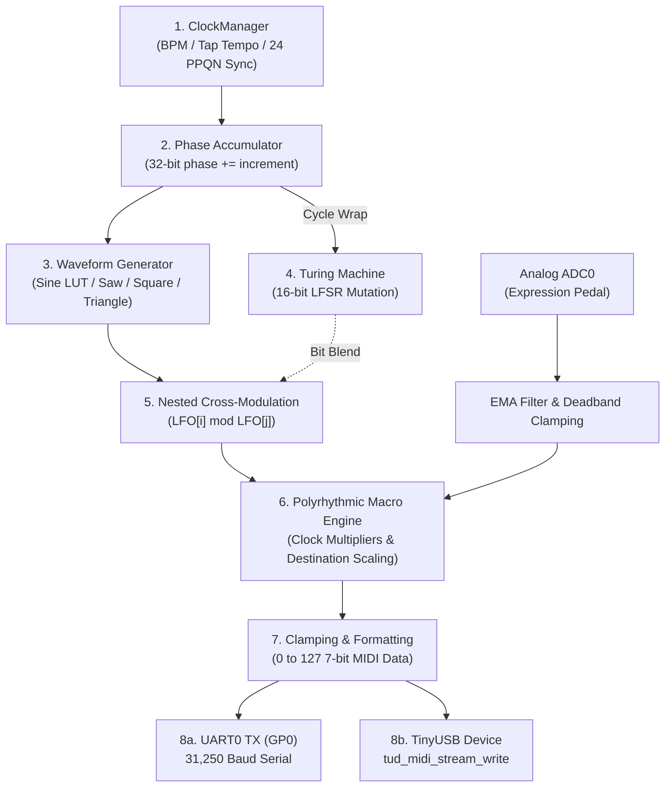

# Phase Box: Developer Architecture & C++ Engineering Guide

> **Implementation status (read first).** The repository currently contains two parallel code stacks:
> the *legacy flat stack* (`PhaseOscillator`, `PhaseBoxState`, `MacroEngine.hpp`, `firmware/`, the native simulator), which is what the firmware and simulator actually build, and
> the *layered stack* (`core/`, `hal/`, `ui/`, `storage/`, `src/main.cpp`), which is covered by the host tests but is not built into the firmware (`src/main.cpp` is in no CMake target).
> The pipeline diagram below mixes both. `Core0Task`, `Core1Task` and the `Mock*` / `Pico*` ADC and display headers now compile on the host (they use the small `AdcInput` / `DisplayInterface` interfaces; `HalAdc` and `HalDisplay` stay concrete for the unit tests), but the layered stack is still not wired into the firmware build.
> Persistence is `fopen`-based (no LittleFS is linked), and `PicoHalFlash` writes need multicore lockout before they are safe alongside Core 0.


This document is the comprehensive architectural specification and developer guide for the **Phase Box** firmware. It details the internal signal flow, dual-core operational model, and code layout.

> [!TIP]
> **For Python Developers:** If you are coming from Python or higher-level languages and want to learn modern embedded C++, see [Section 4: C++ for Pythonistas](#4-c-crash-course-for-python-programmers).

---

## 1. System Architecture & Dual-Core Division

The Raspberry Pi RP2040 contains two 32-bit ARM Cortex-M0+ processor cores operating at 125 MHz. Phase Box uses an **Asymmetric Multiprocessing (AMP)** model to guarantee hard real-time timing for MIDI clock generation without visual or storage stutter.

```
+========================================================================+
|                              RP2040 SOC                                |
|                                                                        |
|  +--------------------------------+  +-------------------------------+ |
|  |             CORE 0             |  |            CORE 1             | |
|  |     (Hard Real-Time 1000 Hz)   |  |   (Asynchronous UI & Storage) | |
|  |                                |  |                               | |
|  |  [Repeating Timer Alarm 1 kHz] |  |  [Polling Loop ~30-60 FPS]    | |
|  |   - Sample ADC0 (Exp. Pedal)   |  |   - Rotary Encoder Polling    | |
|  |   - Phase Accumulator Step     |  |   - Menu Navigation State     | |
|  |   - Turing LFSR Mutation       |  |   - OLED SSD1306 I2C Driver   | |
|  |   - Nested Cross-Modulation    |  |   - Screensaver Inactivity    | |
|  |   - Macro Destination Matrix   |  |   - LittleFS Flash Auto-Save  | |
|  |   - UART0 MIDI Out (31.25k Bd) |  |                               | |
|  |   - TinyUSB MIDI Packet Write  |  +-------------------------------+ |
|  +--------------------------------+                  ^                 |
|                   |                                  |                 |
|                   +-----> [Shared Memory State] <----+                 |
+========================================================================+
```

### Why Core Separation Matters
1. **Interrupt Protection:** Core 0 runs inside a hardware repeating timer interrupt (`add_repeating_timer_us(-1000, ...)`). It executes in under **$45\ \mu\text{s}$**, leaving plenty of headroom.
2. **Eliminating I/O Jitter:** Writing a 512-byte display buffer over I2C or erasing a 4KB sector of SPI NOR flash takes multiple milliseconds. If run on the same core, it would cause audible or visual MIDI clock dropouts. By dedicating Core 1 to display and flash operations, Core 0 never stalls.

---

## 2. Complete Signal Flow Pipeline

Every millisecond (at 1000 Hz), the modulation pipeline computes new MIDI CC values following this deterministic pipeline:



### Signal Stages in Detail

1. **Phase Accumulation:** 
   $$\Delta \text{phase} = \left(\frac{\text{BPM}}{60} \cdot \frac{1}{1000}\right) \cdot 2^{32}$$
   Phase is tracked in a 32-bit unsigned integer (`uint32_t phase_`). Overflows automatically wrap around $2\pi$ seamlessly without expensive modulo math.

2. **Waveform Synthesis:**
   - **Sine:** Evaluated using a 256-entry precomputed lookup table ([LUT](../include/core/phase_lfo.hpp#L90-L96)) with fixed 8-bit quantization.
   - **Sawtooth / Triangle / Square:** Evaluated directly via bit shifts and linear normalization.
   - **Phase Modulation (PM):** Modulates the lookup index by an offset: $\theta_{effective} = \theta + \text{depth} \cdot \sin(2\theta)$.

3. **Turing Mutation Shift Register:**
   A 16-bit recirculating shift register ([Turing machine](../include/TuringMachine.hpp#L20-L30)). On every complete cycle of the master phase accumulator, the top bit is fed back into bit 0. With probability $P_{\text{mutation}}$, the bit is inverted.

4. **Polyrhythmic Macro Destination Evaluation:**
   Each destination tracks an effective phase:
   $$\theta_{\text{dest}} = (\theta_{\text{master}} \cdot \text{clock\_mult}) \pmod{2\pi}$$
   Output scaling is computed as:
   $$\text{value} = \text{clamp}\left(\Big((\text{LFO} \cdot \text{scale} \cdot \text{expression}) + \text{offset}\Big) \cdot 127,\ 0,\ 127\right)$$

---

## 3. Directory Layout & Module Index

```
phase-box/
├── include/                     # Public C++ Header Files
│   ├── core/                    # Core Real-Time Audio/DSP Math
│   │   ├── phase_lfo.hpp        # 32-bit phase accumulator & LUT synthesis
│   │   ├── clock_manager.hpp    # Tap tempo & MIDI clock tracking
│   │   ├── midi_router.hpp      # Channel and CC routing abstractions
│   │   ├── macro_engine.hpp     # Multi-channel expression scaling matrix
│   │   ├── modulation_engine.hpp# Aggregates 4x LFOs, cross-mod, and macros
│   │   ├── core0_task.hpp       # Core 0 1000 Hz repeating interrupt runner
│   │   └── core1_task.hpp       # Core 1 UI and event runner
│   ├── hal/                     # Hardware Abstraction Layer (HAL)
│   │   ├── hal_adc.hpp          # ADC driver interface
│   │   ├── hal_encoder.hpp      # Rotary encoder debouncing interface
│   │   ├── hal_display.hpp      # SSD1306 framebuffer and drawing interface
│   │   ├── hal_flash.hpp        # LittleFS / flash sector interface
│   │   ├── hal_midi.hpp         # UART MIDI transmit/receive interface
│   │   └── mock_*.hpp           # GoogleTest mock implementations for host testing
│   ├── storage/                 # State persistence & LittleFS serializers
│   ├── ui/                      # Menu state machine and screensaver logic
│   ├── PhaseOscillator.hpp      # High-level oscillator model (used by simulator)
│   ├── MacroEngine.hpp          # Polyrhythmic macro destinations class
│   └── TuringMachine.hpp        # Generative LFSR shift register
├── src/                         # C++ Implementations
│   ├── hal/                     # Concrete HAL implementations
│   ├── ui/ui_controller.cpp    # Menu navigation & velocity acceleration
│   ├── storage/preset_manager.cpp # Flash sector read/write implementation
│   ├── native_sim_main.cpp      # Standalone Raylib desktop simulator (macOS CoreMIDI)
│   └── main.cpp                 # Pico firmware entry point (UART model)
├── firmware/                    # Standalone RP2040 Pico SDK Target (TinyUSB + LittleFS)
│   ├── CMakeLists.txt           # Cross-compilation CMake configuration
│   ├── src/firmware_main.cpp    # Target firmware main entry
│   ├── src/screensaver.cpp      # OLED burn-in protection driver
│   ├── src/usb_descriptors.c    # USB MIDI class-compliant endpoints
│   └── include/PresetManager.hpp# Flash auto-save serializer
├── tests/                       # GoogleTest Host Unit Tests
│   ├── CMakeLists.txt           # Standalone test runner build
│   ├── test_macro_engine.cpp    # Verifies macro scaling & bounding
│   ├── test_hal_adc.cpp         # Verifies EMA filter & ADC deadbands
│   └── test_hal_display.cpp     # Verifies SSD1306 framebuffer boundaries
└── docs/                        # Architecture & User Documentation
```

---

## 4. C++ Crash Course for Python Programmers

If you are proficient in Python, embedded C++ might initially look intimidating with its type annotations, headers, and memory pointers. Here is a direct "Rosetta Stone" comparing Python patterns with their exact C++ equivalents in Phase Box.

### 4.1 Headers (`.hpp`) vs. Source (`.cpp`)

* **In Python:** You write code in `module.py` and import it with `import module`.
* **In C++:** Declarations (what functions and classes exist) go into **Header files** (`.hpp`). The definitions (the actual code) go into **Source files** (`.cpp`).

```cpp
// --- phase_lfo.hpp ---
#pragma once // Tells compiler: "Only include this file once per compilation unit"
             // (Prevents duplicate class definition errors, like Python's import cache)

namespace phasebox::core {

class PhaseLFO {
public:
    PhaseLFO();               // Constructor declaration
    uint8_t update();         // Method declaration
    void set_frequency(float hz);

private:
    uint32_t phase_{0};       // Member variable initialized to 0
};

} // namespace phasebox::core
```

### 4.2 Value Types vs. Reference Types (Memory Layout)

In Python, **everything is an object on the heap**, and variables are references:
```python
# Python
a = [1, 2, 3]
b = a          # Both 'a' and 'b' refer to the EXACT SAME list in memory!
b.append(4)
print(a)       # Prints [1, 2, 3, 4]
```

In C++, variables are **values** by default unless explicitly marked as a reference (`&`) or pointer (`*`):
```cpp
// C++
std::vector<int> a = {1, 2, 3};
std::vector<int> b = a;  // Copies the entire vector!
b.push_back(4);
// 'a' is still {1, 2, 3}!

std::vector<int>& c = a; // 'c' is an explicit reference (like Python)
c.push_back(5);
// 'a' is now {1, 2, 3, 5}!
```

> [!IMPORTANT]
> In embedded real-time code (Core 0), we pass large structures by **const reference** (`const MyStruct& data`). This avoids copying memory while preventing accidental modifications, achieving Python-like ergonomics with zero memory allocations!

### 4.3 Structs vs. Classes

In C++, `struct` and `class` are almost identical:
* In a `struct`, members are **`public` by default**.
* In a `class`, members are **`private` by default**.

We use `struct` for plain data bundles (like Python dataclasses):
```cpp
// Like: @dataclass class MacroDestination
struct MacroDestination {
    int cc_number = 16;
    int midi_channel = 1;
    float scale = 1.0f;
    float offset = 0.0f;
    float clock_mult = 1.0f;
};
```

### 4.4 Fixed-Size Arrays (`std::array`) vs. Dynamic Vectors (`std::vector`)

| Feature | Python `list` | C++ `std::vector<T>` | C++ `std::array<T, N>` |
| :--- | :--- | :--- | :--- |
| **Size** | Dynamic | Dynamic (Heap allocated) | **Fixed at compile time (Stack allocated)** |
| **Embedded Safety**| Causes GC pauses | Causes heap fragmentation | **100% deterministic, zero allocations** |
| **Usage in Phase Box**| Prototyping | Desktop simulator / setup | **Used in all real-time Core 0 DSP code** |

```cpp
// Fixed 4-element array allocated entirely on the stack (zero heap allocation!)
std::array<PhaseLFO, 4> lfos_;
```

### 4.5 Bitwise Manipulation in Embedded C++

Because MIDI messages and microcontrollers operate on raw bytes, bitwise operations are common:

```cpp
// 1. Bitwise OR (|) to assemble a MIDI Control Change status byte:
// Status byte 0xB0 means "Control Change" on Channel 1 (0-indexed: 0x0).
// If channel is 2, (channel - 1) is 0x1.
uint8_t status = 0xB0 | ((channel - 1) & 0x0F);

// 2. Bitwise AND (&) to clamp a 7-bit MIDI value (0 to 127):
uint8_t midi_val = raw_value & 0x7F; // Guarantees highest bit is 0

// 3. Bit shifts (<< and >>) in the Turing Machine:
// Shifts register bits left and inserts feedback bit at the bottom:
register_bits = (register_bits << 1) | feedback_bit;
```

---

## 5. How to Contribute New Features

### Recipe 1: Adding a New Waveform Shape

1. **Add Enum Value:** In [include/core/phase_lfo.hpp](../include/core/phase_lfo.hpp#L8-L14), add your new waveform to the `Waveform` enum:
   ```cpp
   enum class Waveform {
       Sine,
       Triangle,
       Square,
       SampleAndHold,
       TuringMutation,
       ExponentialRamp // <-- Your new waveform
   };
   ```

2. **Implement Waveform Math:** In `PhaseLFO::update()`:
   ```cpp
   case Waveform::ExponentialRamp: {
       float norm = static_cast<float>(phase_) / 4294967296.0f;
       return static_cast<uint8_t>(norm * norm * 127.0f);
   }
   ```

3. **Expose in UI:** In [include/PhaseOscillator.hpp](../include/PhaseOscillator.hpp) and the OLED display strings in [native_sim_main.cpp](../src/native_sim_main.cpp#L71), add the name label `"EXP"` to the waveform list.

---

### Recipe 2: Adjusting Hardware Pinout

Hardware pin mappings are defined in the HAL headers and drivers. To change a pin, update the corresponding default argument or constant:
* **MIDI TX/RX:** [include/hal/pico_hal_midi.hpp](../include/hal/pico_hal_midi.hpp) (Default: GP0 TX, GP1 RX).
* **Rotary Encoder:** [include/hal/pinout.hpp](../include/hal/pinout.hpp) (Default: GP2 A, GP3 B, GP6 Pushbutton).
* **OLED I2C:** [include/hal/pinout.hpp](../include/hal/pinout.hpp) for the layered stack and [firmware/src/screensaver.cpp](../firmware/src/screensaver.cpp#L10-L16) for the firmware build (Default: GP4 SDA, GP5 SCL on `i2c0`). Keep both in sync.
* **Expression ADC:** [include/hal/pinout.hpp](../include/hal/pinout.hpp) (Default: GP26 / ADC0).

---

### Recipe 3: Writing a Unit Test (GoogleTest)

All algorithmic DSP math can be tested on your Mac/Linux host without hardware.
1. Open or create a test file in `tests/` (e.g. `tests/test_my_feature.cpp`).
2. Write a test case:
   ```cpp
   #include <gtest/gtest.h>
   #include "core/phase_lfo.hpp"

   TEST(PhaseLFOTest, FrequencyIncrementMatchesExpectation) {
       phasebox::core::PhaseLFO lfo;
       lfo.set_frequency(1.0f, 1000); // 1 Hz at 1000 Hz sample rate
       
       // In 250 ticks (1/4 second), Sine LUT should reach its peak value (~127)
       uint8_t val = 0;
       for (int i = 0; i < 250; ++i) {
           val = lfo.update();
       }
       EXPECT_NEAR(val, 127, 4);
   }
   ```
3. Add the test file to `tests/CMakeLists.txt` and run the suite:
   ```bash
   /Applications/CMake.app/Contents/bin/cmake -S tests -B build-test -DCMAKE_POLICY_VERSION_MINIMUM=3.5
   /Applications/CMake.app/Contents/bin/cmake --build build-test -j4
   ./build-test/run_host_tests
   ```

---

### Recipe 4: Compiling Deployable RP2040 Firmware (`.uf2`)

When you are ready to flash your code onto physical hardware:

```bash
# 1. Ensure toolchain environment variables are set:
export PATH="/Applications/CMake.app/Contents/bin:/Users/ww/tools/xpack-arm-none-eabi-gcc-15.2.1-1.1/bin:$PATH"
export PICO_SDK_PATH="/Users/ww/tools/pico-sdk"

# 2. Build target firmware:
cmake --build firmware/build -j4

# 3. Output files:
#    - firmware/build/phase_box_firmware.uf2 (Drag-and-drop to Pico in BOOTSEL mode)
#    - firmware/build/phase_box_firmware.elf (For GDB/Picoprobe debugging)
```
